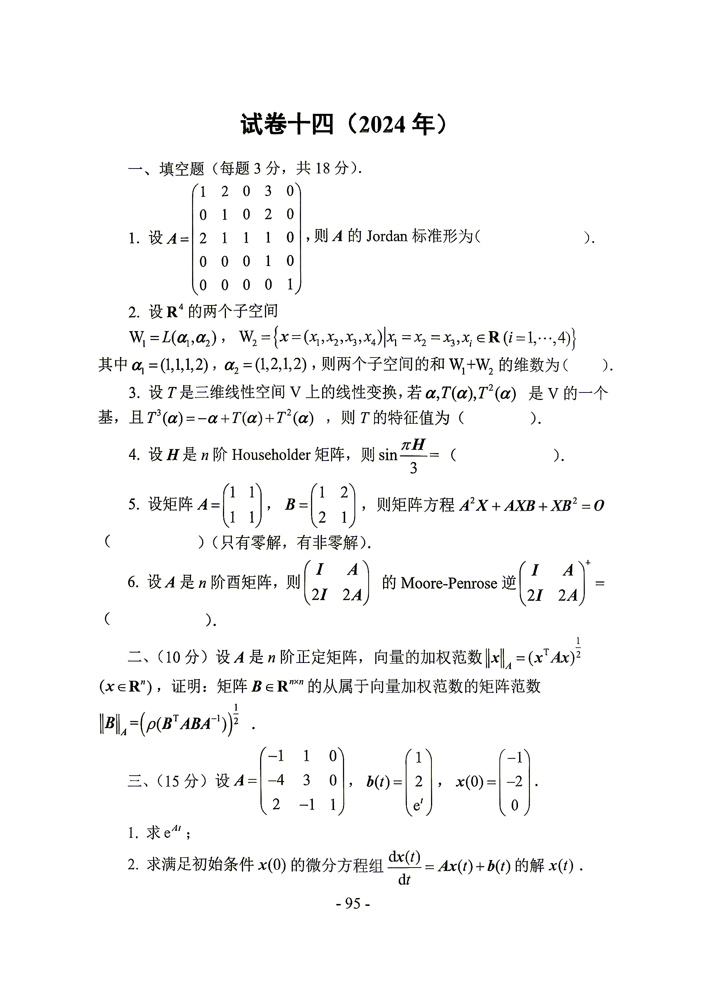
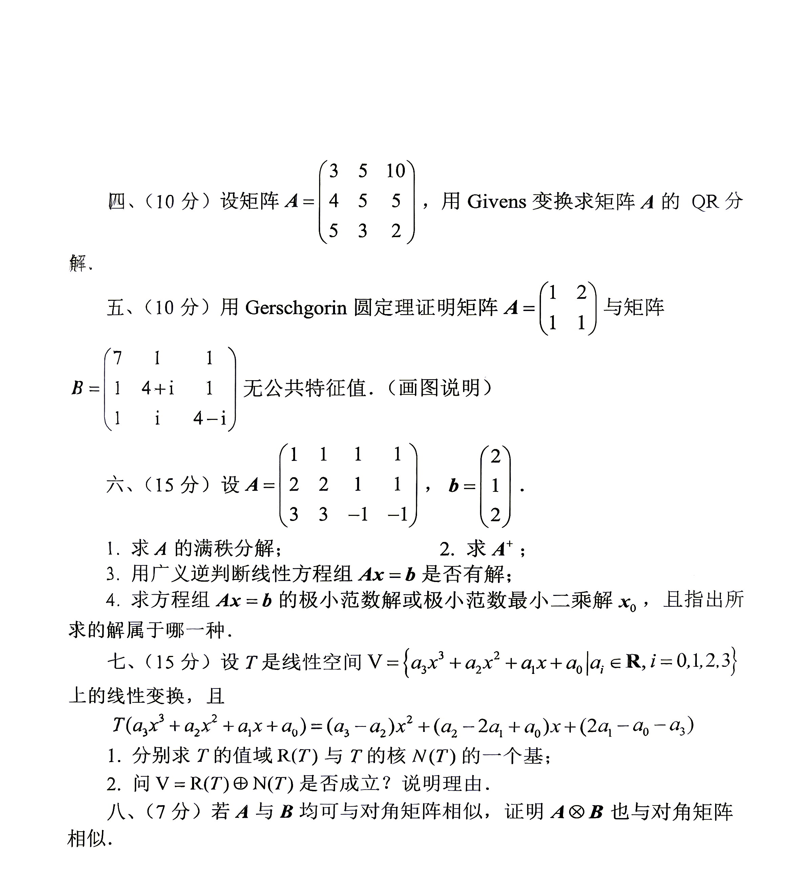

# 2024年

# 试卷十四（2024年）
## 一、填空题（每题3分，共18分）
1. 设 

$$
A = \begin{pmatrix} 1 & 2 & 0 & 3 & 0 \cr 0 & 1 & 0 & 2 & 0 \cr 2 & 1 & 1 & 1 & 0 \cr 0 & 0 & 0 & 1 & 0 \cr 0 & 0 & 0 & 0 & 1 \end{pmatrix}
$$

，则 $A$ 的 Jordan 标准形为（ ）。

2. 设 $\mathbb{R}^4$ 的两个子空间

   

$$
W_1 = L(\alpha_1, \alpha_2), \quad W_2 = \lbrace x = (x_1, x_2, x_3, x_4) \mid x_1 = x_2 = x_3, x_i \in \mathbb{R}\ (i = 1, \cdots, 4)\rbrace
$$

   其中 $\alpha_1 = (1, 1, 1, 2)$ ， $\alpha_2 = (1, 2, 1, 2)$ ，则两个子空间的和 $W_1 + W_2$ 的维数为（ ）。

3. 设 $T$ 是三维线性空间 $V$ 上的线性变换，若 $\alpha, T(\alpha), T^2(\alpha)$ 是 $V$ 的一个基，且 $T^3(\alpha) = -\alpha + T(\alpha) + T^2(\alpha)$ ，则 $T$ 的特征值为（ ）。

4. 设 $H$ 是 $n$ 阶 Householder 矩阵，则 $\sin \frac{\pi H}{3} =$ （ ）。

5. 设矩阵 

$$
A = \begin{pmatrix} 1 & 1 \cr 1 & 1 \end{pmatrix}
$$

，

$$
B = \begin{pmatrix} 1 & 2 \cr 2 & 1 \end{pmatrix}
$$

，则矩阵方程 $A^2 X + AXB + XB^2 = O$ （ ）（只有零解，有非零解）。

6. 设 $A$ 是 $n$ 阶酉矩阵，则 

$$
\begin{pmatrix} I & A \cr 2I & 2A \end{pmatrix}
$$

 的 Moore-Penrose 逆 

$$
\begin{pmatrix} I & A \cr 2I & 2A \end{pmatrix}^+ =
$$

（ ）。

---

## 二、（10分）
设 $A$ 是 $n$ 阶正定矩阵，向量的加权范数 $\Vert x\Vert_A = (x^\top A x)^{\frac{1}{2}}\ (x \in \mathbb{R}^n)$ ，证明：矩阵 $B \in \mathbb{R}^{n \times n}$ 的从属于向量加权范数的矩阵范数

$$
\Vert B\Vert_A = \left(\rho(B^\top A B A^{-1})\right)^{\frac{1}{2}}.
$$

---

## 三、（15分）
设 

$$
A = \begin{pmatrix} -1 & 1 & 0 \cr -4 & 3 & 0 \cr 2 & -1 & 1 \end{pmatrix}
$$

，

$$
b(t) = \begin{pmatrix} 1 \cr 2 \cr e^t \end{pmatrix}
$$

，

$$
x(0) = \begin{pmatrix} -1 \cr -2 \cr 0 \end{pmatrix}
$$

。

1. 求 $e^{At}$ ；
2. 求满足初始条件 $x(0)$ 的微分方程组 $\frac{\mathrm{d}x(t)}{\mathrm{d}t} = Ax(t) + b(t)$ 的解 $x(t)$ 。

---

## 四、（10分）
设矩阵 

$$
A = \begin{pmatrix} 3 & 5 & 10 \cr 4 & 5 & 5 \cr 5 & 3 & 2 \end{pmatrix}
$$

，用 Givens 变换求矩阵 $A$ 的 QR 分解。

---

## 五、（10分）
用 Gerschgorin 圆定理证明矩阵 

$$
A = \begin{pmatrix} 1 & 2 \cr 1 & 1 \end{pmatrix}
$$

 与矩阵

$$
B = \begin{pmatrix} 7 & 1 & 1 \cr 1 & 4+\mathrm{i} & 1 \cr 1 & \mathrm{i} & 4-\mathrm{i} \end{pmatrix}
$$

无公共特征值。（画图说明）

---

## 六、（15分）
设 

$$
A = \begin{pmatrix} 1 & 1 & 1 & 1 \cr 2 & 2 & 1 & 1 \cr 3 & 3 & -1 & -1 \end{pmatrix}
$$

，

$$
b = \begin{pmatrix} 2 \cr 1 \cr 2 \end{pmatrix}
$$

。

1. 求 $A$ 的满秩分解；
2. 求 $A^+$ ；
3. 用广义逆判断线性方程组 $Ax = b$ 是否有解；
4. 求方程组 $Ax = b$ 的极小范数解或极小范数最小二乘解 $x_0$ ，且指出所求的解属于哪一种。

---

## 七、（15分）
设 $T$ 是线性空间 $V = \lbrace a_3 x^3 + a_2 x^2 + a_1 x + a_0 \mid a_i \in \mathbb{R}, i = 0, 1, 2, 3\rbrace$ 上的线性变换，且

$$
T(a_3 x^3 + a_2 x^2 + a_1 x + a_0) = (a_3 - a_2)x^2 + (a_2 - 2a_1 + a_0)x + (2a_1 - a_0 - a_3)
$$

1. 分别求 $T$ 的值域 $R(T)$ 与 $T$ 的核 $N(T)$ 的一个基；
2. 问 $V = R(T) \oplus N(T)$ 是否成立？说明理由。

---

## 八、（7分）
若 $A$ 与 $B$ 均可与对角矩阵相似，证明 $A \otimes B$ 也与对角矩阵相似。

---

